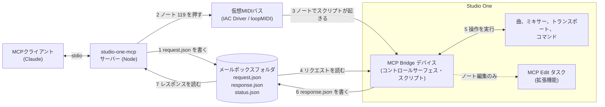
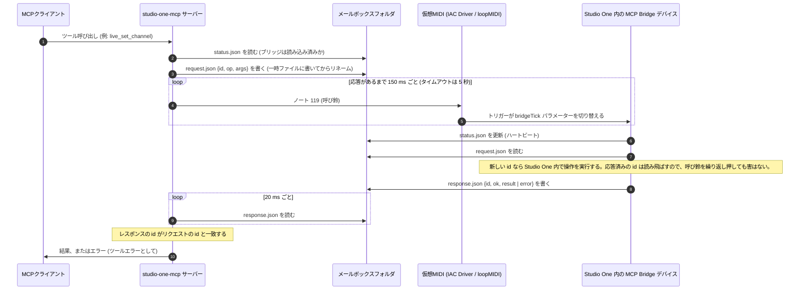

# studio-one-mcp

PreSonus **Studio One** 用の [MCP](https://modelcontextprotocol.io) サーバーです。Claude などの MCP クライアントから、曲の中身を読んだり、起動中の Studio One を操作したりできます。

Studio One には、公開 API も、OSC も、ネットワーク経由のスクリプト機能もありません。このサーバーは、Studio One が実際に持っている次の2つの仕組みを組み合わせています。

| 層 | 仕組み | Studio One の起動は必要か |
|---|---|---|
| **`song_*` ツール** | `.song` ファイル（XML を zip で固めたもの）を解析します。テンポマップ、拍子、マーカー、アレンジャーセクション、トラック、テイク、クリップ、ミキサー、プラグインのインサート、メディアを読めます。 | 不要。最後に保存またはオートセーブした時点の状態が見えます。 |
| **`live_*` ツール** | Studio One に入れる小さなコントロールサーフェス・デバイスが、ローカルの **ファイルメールボックス** を介してリクエストに答えます。Studio One 自身の JavaScript デバイス SDK を使います。 | 必要 |

ステータス: 開発初期です。**macOS 上の Studio One 5.5.2** を相手に開発しました。Windows と、Studio One 6/7、Studio Pro 8 向けのパスは用意してありますが、ほとんど検証できていません。Windows 11 + Studio One 6 では、ブリッジの疎通確認（`ping` への応答）までは確認しました。個々の `live_*` ツールの動作は確認していません。

独立したプロジェクトであり、PreSonus や Fender とは無関係で、公認も受けていません。Studio One は PreSonus の商標です。

## ツール一覧

| ツール | できること |
|---|---|
| `song_list` | ディスク上の曲を新しい順に一覧します。オートセーブしか存在しない曲も含みます。 |
| `song_read` | 1曲を `summary`（1トラック1行）または `full`（すべてのテイクとクリップ、インストゥルメントのノート、各プラグインの保存済み設定、オートメーションのエンベロープ）で返します。どちらにも、曲のノートとチャンネルのノートがあれば含まれます。位置は小節/拍と秒の両方で示します。 |
| `song_history` | 曲のオートセーブの一覧。バージョンの比較に使います。 |
| `song_diff` | 2つの保存状態の差分: テンポ、拍子、マーカー、セクション、トラック（追加、削除、名前変更、テイク、イベント、ノート）、ミキサー（レベル、ミュート/ソロ、オートメーションモード、出力、プラグインとその設定）、オートメーション。既定では、曲を最新のオートセーブと比べます（古い方から新しい方へ）。 |
| `live_status` | ブリッジに到達できるか。できない場合は理由も返します。 |
| `live_song` | いま開いている曲の現在の状態（未保存の変更を含む）: タイトル、ファイルパス、トランスポート（再生中、録音中、ループ、位置、テンポ、ループ範囲、プリカウント、プリロール）、トラック数、選択中のトラック。 |
| `live_tracks` | トラックの一覧: メディアタイプ、色、ミキサーチャンネル、テイク数、選択状態、イベント（名前、開始、終了、秒単位の長さ、ミュート）。 |
| `live_select_track` | 名前でトラックを選択します。選択に対して働くコマンドが、そのトラックに作用するようになります。 |
| `live_transport` | トランスポートのボタンを押します: 再生、停止、録音、ゼロに戻る、1小節の巻き戻し/早送り、ループの開始/終了へ移動、ループ・クリック・プリカウント・プリロールの切り替え。 |
| `live_set_transport` | テンポ、プレイヘッド位置（秒、または `"9.1.1.0"` のような小節表記）、ループ/プリカウント/プリロールのオンオフを設定します。 |
| `live_markers` | マーカーの番号、位置（秒と小節）、名前（マーカートラックからライブで取得）。読み取り中はプレイヘッドを一時的に動かして元に戻すため、再生中は拒否します。Studio One がマーカーに持っている呼び出しコマンドは 1〜20 番だけです。 |
| `live_add_marker` / `live_delete_marker` / `live_rename_marker` | 指定位置（秒または小節）にマーカーを追加（名前は任意）、番号または位置で削除、番号または名前で名前変更。プレイヘッドは元の位置のままです。 |
| `live_select_events` | 一部またはすべてのトラックのイベントをすべて選択、または選択解除します。その後は、選択に対して働くコマンドがそれらのイベントに作用します。例: `Event/Mute Events`、`Edit/Split at Cursor`、`Event/Quantize`、`Track/Activate Next Layer`（テイクの切り替え）、`Edit/Undo`。 |
| `live_set_loop` | ループ範囲を秒または小節（例: `"9.1.1.0"` から `"17.1.1.0"`）で設定し、ループのオンオフを切り替えます。 |
| `live_takes` | トラックのテイク: 一覧（名前は最後の保存時点のもの）、次/前のテイクまたは N 番目への切り替え、空のテイクの追加またはアクティブなテイクの複製、別々のトラックへの展開（unpack）、遡及録音（retrospective recording）の呼び出し。 |
| `live_track_state` | 名前でトラックを指定して、録音待機（arm）、モニター、ミュート、ソロ、非表示、複製。または、すべてのトラックを表示します。 |
| `live_edit_events` | 1トラック上のクリップ編集: ミュート/ミュート解除、クオンタイズ、トランスポーズ、指定時刻での分割/トリム、結合、削除。 |
| `live_events` | トラック上の1つのイベントを、番号（時間順）または名前で指定します。一覧（オーディオはゲインとフェード付き）、**編集**（位置へ移動、別トラックへ移動、ゲインを dB で設定/追加、フェードイン/アウト。アンドゥ1回分）、N 回の**複製**、任意のトラックの指定位置への**コピー**（クリップボード経由）ができます。 |
| `live_add_track` | オーディオ（モノ/ステレオ）、インストゥルメント、フォルダ、オートメーションのトラックを追加します。 |
| `live_meters` | 全チャンネルのピーク dB。`duration_ms` を指定すると、再生中にサンプリングして、最大ピークとクリップの有無を返します。 |
| `live_save`, `live_undo`, `live_redo` | 保存（新しいバージョンとして保存も可）、編集のアンドゥ/リドゥ（ステップ数を指定可）。アンドゥのステップ数を数えるのではなく、結果を確認してください: [アンドゥ](#アンドゥ)を参照。 |
| `live_plugins` / `live_add_plugin` | インストール済みのプラグインを名前で一覧します（PreSonus、VST、AU）。エフェクトのほか、`kind: "instrument"` でインストゥルメントも。エフェクトを名前で指定してチャンネルのインサートに追加します。アンドゥ1回で外せます。 |
| `live_add_send` | エフェクトセンドを追加します。Studio One がプラグイン入りの新しい FX チャンネルと、そこへのセンドを作ります（リバーブやディレイのセンド）。既存のバスへのセンドはスクリプトから届かず、この操作は確実にはアンドゥできません。 |
| `live_add_instrument_track` | インストゥルメント（Mai Tai、Presence…）を名前で指定し、その新しいインスタンス付きのインストゥルメントトラックを追加します。アンドゥ1回で両方が消えます。 |
| `live_inserts` / `live_bypass_insert` | 各チャンネルのプラグイン（スロット、名前、バイパス状態）。1つのスロット、またはラック全体をバイパスします。 |
| `live_sends` / `live_set_send` | 各チャンネルのセンド（宛先名、レベル 0..1 と dB、ミュート）の取得と、レベルやミュートの設定。 |
| `live_plugin_params` / `live_set_plugin_param` | プラグインのパラメーター（値、`"2.0:1"` のような表示テキスト、範囲、正規化値）の取得と、表示テキスト・正規化値・生の値による設定。Studio One はプラグインのパラメーター一覧を取得できないため、名前はプリセットと Studio One のリモコンマップ（PreSonus のプラグインを網羅）から得ます。それ以外のプラグインでは、名前を渡してください。 |
| `live_mix_snapshot` | ミックス全体に名前を付けて保存し（各チャンネルのボリューム、パン、ミュート、ソロ、モニタリング、センドレベル。曲ごと）、後で復元、または一覧表示します。復元は、違っている部分だけを設定します。録音待機とオートメーションモードは含みません。 |
| `live_plugin_snapshot` | プラグインの現在の設定に名前を付けて保存し、同じ種類のプラグインに（別のチャンネル上でも）復元します。プリセットの代用です。Studio One のプリセット関連コマンドは、フォーカス中のエディタウィンドウに作用し、ダイアログ経由で保存するためです。 |
| `live_record_setup` | メトロノーム（クリック、プリカウントとその小節数、プリロール）の取得と設定、録音モード（置き換え、ループテイクまたはミックス、テイクをレイヤーへ、入力クオンタイズ、ノート消去）の設定。録音モードは Studio One が読み取りを公開していないため、「設定した」とだけ報告し、確認はしません。オートパンチ: オフ、イン、アウト、両方、パンチ範囲付き（Studio One はループロケーターの間でパンチします。ループはオンになりません）。 |
| `live_set_automation` | チャンネルのオートメーションモードを設定します: オフ、リード、タッチ、ラッチ、ライト。`live_channels` で各チャンネルのモードが分かります。 |
| `live_write_automation` | ボリューム（dB）またはパンのオートメーションを、点と点を直線で結んで書き込みます。スクリプトからはエンベロープの点を追加できないため、Write モードでフェーダーを曲線に追従させながら、その範囲を1回再生して書き込み、最後にチャンネルを Read に戻します。音が出ます。`confirm: true` のときだけ実行します。 |
| `live_arranger` | アレンジャーのセクション: 一覧（ライブ）、番号または名前で移動（再生中はシンクポイントでのジャンプ、停止中はプレイヘッドの移動）、再生中に次/前へ、シンクモードの設定、マーカーからのセクション作成、セクションの**追加・名前変更・サイズ変更・移動・削除**（それぞれアンドゥ1回。セクション下のイベントは動きません）。全トラックの中身ごと扱う操作もあります: セクションを指定位置に**コピー**（後続は後ろにずれる）、**削除**して隙間を詰める、**移動**（`content: true`）。ループ範囲は維持されます。 |
| `live_macros` / `live_run_macro` | マクロ（組み込みとユーザー作成）をタイトルで一覧し、タイトルを指定して実行します。実行せずに、有効かどうかだけ確認することもできます。 |
| `live_time_signature` | 任意の位置の拍子の取得、小節への拍子の挿入、削除。それぞれアンドゥ1回です。 |
| `live_tempo` | 任意の位置のテンポの取得、ある位置を含む区間のテンポの設定、テンポ変更の挿入。Studio One が停止中である必要があります。プレイヘッドは元に戻します。挿入したテンポ変更の削除はアンドゥで行うため、あとで `at` を指定して確認してください。 |
| `live_notes` | インストゥルメントトラックのパート内のノート: ピッチ（番号と名前。中央のド = C3）、ベロシティ 0〜127、秒単位の開始・終了・長さ、拍単位の開始。読み取り専用です。 |
| `live_edit_notes` | インストゥルメントトラックのノートを編集します: トランスポーズ、ベロシティの設定/変更、移動、長さの変更、クオンタイズ（`1/16`、`1/8T`、`1/8.` のようなグリッドと強さを指定）、削除（フィルター付き）、ノートの追加。ピッチと拍の範囲で絞り込めます。デバイスと一緒に入る小さな編集タスク拡張機能を経由するので、ダイアログは開かず、Studio One 自身のクオンタイズ設定にも触れません。 |
| `live_create_part` | インストゥルメントトラックに、開始から終了（秒または小節）までのインストゥルメントパート（MIDI クリップ）を作り、必要ならノートを入れます。空のトラックでも動きます。ノートの拍は、パートの先頭から数えます。アンドゥ1回で、パートとノートが消えます。 |
| `live_add_notes` | インストゥルメントトラックの1つのパートに、番号または名前を指定してノートを追加します。空のパートでも可。拍は、そのパートの先頭から数えます。パートが複数あるトラックでは、`live_edit_notes` の add が最初のパートに入ってしまうので、こちらを使ってください。 |
| `live_track_edit` | トラック名を指定して、名前の変更、色の変更（`"#rrggbb"`）、削除、別のトラックの前後への**移動**、出力のバスや出力への**ルーティング**、**フォルダ**への移動（必要なら作成）、**イベント名の変更**（必要なら時間順の連番）を行います。名前と色はアンドゥの対象外です。ルーティングは、返される「変更前」の値で戻せます。削除、移動、フォルダ、イベント名の変更はアンドゥできます。移動、ルーティング、フォルダ、イベント名の変更は、拡張機能内の **MCP Track Edit** タスクで実行します。 |
| `live_bounce` | トラック上のすべてのイベントを、その場で、または新しいトラックにバウンスします（元のイベントはミュートされます）。ダイアログは開きません。アンドゥ1回で戻せます。書き出されたファイルは、曲の Bounces フォルダに残ります。ミックスダウンとステム書き出しはダイアログが開くので、提供していません。 |
| `live_record` | 録音します。テイクが曲に書き込まれます。`confirm: true` のときだけ実行します。先にトラックを録音待機にする、位置から開始する、プリカウントを設定する、N 秒後に停止する、といったことができます。 |
| `live_channels` | ライブのミキサー: 各チャンネルのボリューム、パン、ミュート、ソロ、録音待機、入力モニタリング、オートメーションモード、ルーティング（入力と出力を名前で）。トラックの出力を変えるには、`live_track_edit` の `route` を使います。 |
| `live_set_channel` | チャンネルのボリューム、パン、ミュート、ソロ、録音待機、入力モニタリングを設定します。 |
| `live_add_bus` | 複数のトラック用のバス（それらの出力がバスにルーティングされます）、またはそれらを制御する VCA を作ります。アンドゥ1回で削除され、ルーティングも元に戻ります。 |
| `live_command` | Studio One の約1,000個のコマンドのどれでも実行できます。例: `Transport/Start`、`Edit/Undo`、`File/Save`、`View/Console`。`check_only` を指定すると、実行せずに有効かどうかだけ報告します。 |
| `live_list_commands` | コマンド名を探します。必要なら、いま有効かどうかも付けます。 |
| `live_changes` | 前回の呼び出し以降に曲で変わったこと: トラックの追加・削除・名前変更・並べ替え、各トラックのイベント、ミキサーの変更（レベル、ミュートとソロ、録音待機、モニター、オートメーションモード、出力、プラグイン）、テンポ、ループ、マーカー、セクション。スナップショットを比較するので、手で行った操作も、正味の変化として見えます。 |
| `live_eval` | Studio One の中で JavaScript を実行し、そのオブジェクトモデルを調べます。明示的に有効にした場合のみ使えます。 |

## 導入（ゼロから）

MCP サーバーは、自分で起動して待ち受けさせるものではありません。Claude Code や Claude Desktop などの **MCP クライアント** が、登録された設定に従って `node src/server.js` を子プロセスとして自動で起動し、標準入出力（stdio）で会話します。手で `node src/server.js` を実行しても、何も表示されないまま入力待ちになるだけで、それが正常です。

そのため「導入」とは、次の4つを用意することです。

- **A. サーバー本体**: Node.js と、このリポジトリ。
- **B. Studio One 側の部品**: MCP Bridge デバイスと編集タスク拡張機能、そして **仮想MIDIポート**（`live_*` ツールにだけ必要）。
- **C. クライアントへの登録**: どのコマンドでサーバーを起動するか。
- **D. 環境変数**: 曲フォルダ、MIDIポート名など。登録の `env` に書きます。

`song_*` ツールだけ使うなら、B は不要です。A・C・D だけで動きます。`setup` コマンドは、B のうちデバイスと拡張機能の導入と、C のクライアントへの登録を、対話式で進めてくれます。ただし、Node.js とリポジトリの用意（A）、仮想MIDIポートの作成（B の一部）、曲フォルダなどの環境変数（D）は、自分で行う必要があります。以下は、まっさらな PC で通しで行う手順です。

### 必要なもの

| もの | 用途 | 入手・確認 |
|---|---|---|
| Node.js 20 以上 | サーバーの実行 | <https://nodejs.org/>。インストール後は PowerShell を開き直してから、`node -v` で確認します（PATH を反映するため）。 |
| Git | リポジトリの取得 | `git --version` で確認します。 |
| Studio One | 対象の DAW | 導入前に **一度起動して終了** しておきます（ユーザープロファイルが作られます）。 |
| MCP クライアント | サーバーを呼び出す側 | Claude Code（CLI または VS Code 拡張）、Claude Desktop など。 |
| 仮想MIDIポート | `live_*` の「呼び鈴」 | macOS: IAC Driver（OS 標準）。Windows: [loopMIDI](https://www.tobias-erichsen.de/software/loopmidi.html)（無料）。 |

### 1. 仮想MIDIポートを用意する（`live_*` を使う場合）

Studio One のスクリプトはソケットを開けないので、サーバーは「リクエストを書いたよ」と知らせる呼び鈴として、仮想MIDIポートにMIDIノートを送ります（しくみは[ライブブリッジのしくみ](#ライブブリッジのしくみ)を参照）。

- **Windows**: loopMIDI をインストールして起動し、ポート名の欄に `studio-one-mcp` と入力して **+** ボタンでポートを追加します。loopMIDI は常駐アプリで、起動している間だけポートが存在します。Windows の起動時に自動で立ち上がるようにしておくと楽です。
- **macOS**: OS 標準の IAC Driver を有効にします。Audio MIDI Setup を開き、Window → Show MIDI Studio → **IAC Driver** をダブルクリックして、**Device is online** にチェックを入れます（日本語表示の macOS では、対応する日本語名の項目です。`setup` が Audio MIDI Setup を開くこともできます）。

### 2. リポジトリを取得する

```powershell
git clone https://github.com/mo-1176/studio-one-mcp.git
cd studio-one-mcp
npm install
```

- 置き場所は固定してください。クライアントへの登録にこのフォルダの絶対パスが記録されるので、あとで移動すると、サーバーが起動しなくなります。
- クローンせずに、npm に公開されている版を使うこともできます。その場合は上の3行を省き、以降の `npm run setup` を `npx -y studio-one-mcp setup` に読み替えます。公開版は更新が遅れていることがあり、このリポジトリの最新の修正を含まない場合があります。

### 3. Studio One を一度起動して終了する

初回の起動で、ユーザープロファイルが作られます。

- Windows: `%APPDATA%\PreSonus\Studio One 6` など
- macOS: `~/Library/Application Support/PreSonus/Studio One 6` など

`setup` は、ここにデバイスを入れます。すでに Studio One を使っているなら、この手順は不要です。

### 4. `setup` を実行する

Windows（PowerShell）:

```powershell
npm run setup -- --profile "$env:APPDATA\PreSonus\Studio One 6"
```

macOS:

```sh
npm run setup
```

`setup` は、各段階の前に何をするかを表示し、ファイルを変更する前に確認します。オプションは次の3つです。

- `--yes`: 確認を省き、既定の答えを受け入れます。
- `--dry-run`: 何も変更せず、やる予定のことだけ表示します。
- `--profile <dir>`: Studio One のユーザープロファイルを指定します。

Windows では、`--profile` を付けることを勧めます。`Studio One 6` の部分は、`%APPDATA%\PreSonus`（または `%APPDATA%\Fender`）の中にある、実際のユーザーフォルダに合わせてください。付けずに自動検出に任せると、同じ場所に溜まっている Studio One のクラッシュダンプ（`Studio One_….dmp`）を、プロファイルのフォルダと取り違えることがあります。

| 段階 | `setup` がすること | 答え方 |
|---|---|---|
| 1. Studio One | ユーザープロファイルを探して表示します。 | — |
| 2. MCP Bridge device | プロファイルの `User Devices\studio-one-mcp` にブリッジのデバイスを、`Extensions\studio-one-mcp.edittasks` に編集タスク拡張機能を入れます。そのあと、`live_eval`（Studio One の中で任意の JavaScript を実行する、開発用の機能）を有効にするか聞きます。 | インストールは Y。`live_eval` は、通常は **N**（既定）。 |
| 3. Virtual MIDI port | 仮想MIDIポートを探します。見つからなければ、現れるまで最大約3分待ちます。 | 手順1で作ってあれば、そのまま進みます。 |
| 4. Register with your MCP client | Claude Code に登録します（`claude` コマンドが PATH にあるときだけ。全プロジェクトで使える user スコープ）。Claude Desktop にも登録できます（既定は No。元の設定ファイルは `.bak-日時` の名前でバックアップします）。どのクライアントにも使える JSON も表示します。 | 使うクライアントに Y。 |
| 5. In Studio One | Studio One 側でやる操作（次の手順5）を表示します。 | — |
| 6. Check the connection | Studio One が `ping` に答えるまで、最大約3分待ちます。 | **手順5を済ませてから** Y。後回しなら n（あとで `doctor` で確認できます）。 |

補足:

- 仮想MIDIポートが複数あると、`setup` が意図と違うポートを選ぶことがあります（名前に `studio-one-mcp` または `loopMIDI` を含むポートのうち、先に見つかったものを選びます）。段階3の `Using "…"` と、段階5の `Receive From:` に表示された名前を、手順5の Studio One の設定と、手順6〜7の `STUDIO_ONE_MCP_MIDI_PORT` に揃えてください。
- `claude` コマンド（Claude Code CLI）が PATH に無いと、段階4は Claude Code の項目を黙って飛ばします。VS Code 拡張だけを入れている場合などです。その場合は、手順6で手動登録します。

### 5. Studio One に MCP Bridge を追加する（1回だけ）

1. Studio One が起動中なら、いったん終了して起動し直します。デバイスと拡張機能は、起動時にしか読み込まれません。
2. Windows は Studio One の **Options**、macOS は **Preferences…**（⌘,）を開き、**External Devices** → **Add…** を選びます。
3. 一覧から `studio-one-mcp` → **MCP Bridge** を選んで OK を押します。
4. **Receive From** に、仮想MIDIポート（`setup` が表示した名前。例: `studio-one-mcp`）を選びます。**Send To** は **None** にします。

### 6. MCP クライアントに登録する

`setup` が登録を済ませているなら、確認だけで足ります。

#### Claude Code

`claude` コマンドが使える場合は、登録を確認します。

```powershell
claude mcp list
```

`studio-one` が無いときは、手動で登録します。

```powershell
claude mcp add --env STUDIO_ONE_MCP_MIDI_PORT=studio-one-mcp --env "STUDIO_ONE_SONGS=D:\共有\プロジェクト" --transport stdio --scope user studio-one -- node "D:\tools\studio-one-mcp\src\server.js"
```

- `--scope user` にすると、どのフォルダで Claude Code を開いても使えます。
- `--env` は、サーバーに渡す環境変数です（1つにつき1回書きます）。`--env` の直後にサーバー名を置くと、名前まで環境変数として解釈されて拒否されます。そのため、間に `--transport stdio` などの別のオプションを挟みます。
- `--` より後ろが、サーバーを起動するコマンドです。`D:\tools\studio-one-mcp` は、手順2で取得した場所に置き換えてください。
- 曲が `Documents\Studio One\Songs` にあるなら、`STUDIO_ONE_SONGS` は不要です。macOS で IAC Driver を使うなら、`STUDIO_ONE_MCP_MIDI_PORT` も不要です。
- Claude Code の中では、`/mcp` で各サーバーの状態を確認でき、再接続もできます。

このリポジトリの直下には `.mcp.json` があります。これは **プロジェクトスコープ** の登録で、このリポジトリのフォルダを Claude Code で開いたときだけ有効です（初回は承認を求められます）。同じ名前（`studio-one`）が複数のスコープにあると、Claude Code は優先順位の高い方（local → project → user）を **丸ごと** 使い、項目は合成されません。つまり、`.mcp.json` に `env` が無ければ、user スコープに書いた `env`（曲フォルダ、MIDIポート名）は、このフォルダでは効きません。このフォルダで使うなら `.mcp.json` にも `env` を書くか、別のフォルダで Claude Code を開いてください。

`claude` コマンドが無く、VS Code 拡張だけで使っている場合は、Claude Code CLI を別途入れて上のコマンドを実行するか、作業フォルダ直下の `.mcp.json` に書きます。

```json
{
  "mcpServers": {
    "studio-one": {
      "command": "node",
      "args": ["D:\\tools\\studio-one-mcp\\src\\server.js"],
      "env": {
        "STUDIO_ONE_MCP_MIDI_PORT": "studio-one-mcp",
        "STUDIO_ONE_SONGS": "D:\\共有\\プロジェクト"
      }
    }
  }
}
```

JSON なので、`\` は `\\` と書きます。個人のパスが入るので、共有リポジトリにはコミットしないでください。`.mcp.json` の値には、`${変数名}` や `${変数名:-既定値}` で OS の環境変数を埋め込むこともできます（未設定で既定値もないと、警告が出て、`${変数名}` という文字列がそのまま渡されます）。詳しくは Claude Code の[公式ドキュメント](https://code.claude.com/docs/en/mcp)を参照してください。

#### Claude Desktop

`setup` の段階4で `y` と答えると追加されます。手動の場合は、設定ファイルの `mcpServers` に追加して、Claude Desktop を再起動します。

- Windows: `%APPDATA%\Claude\claude_desktop_config.json`
- macOS: `~/Library/Application Support/Claude/claude_desktop_config.json`

```json
{
  "mcpServers": {
    "studio-one": {
      "command": "C:\\Program Files\\nodejs\\node.exe",
      "args": ["D:\\tools\\studio-one-mcp\\src\\server.js"],
      "env": {
        "STUDIO_ONE_MCP_MIDI_PORT": "studio-one-mcp",
        "STUDIO_ONE_SONGS": "D:\\共有\\プロジェクト"
      }
    }
  }
}
```

`command` には `node` の絶対パスを書きます（`setup` もそうしています。Windows では `where.exe node` で調べられます）。

#### その他のクライアント

`setup` の段階4が表示する JSON（`{"mcpServers":{"studio-one":{…}}}`）を、そのクライアントの MCP 設定に貼ります。

### 7. 曲フォルダと MIDI ポート名を、登録の `env` に書く

`song_*` は、既定では `~/Documents/Studio One/Songs`（と `~/Documents/Studio Pro/Songs`）にある曲を探します。曲をほかの場所に置いているなら、`STUDIO_ONE_SONGS` でフォルダを教えます。Windows で `live_*` を使うなら、`STUDIO_ONE_MCP_MIDI_PORT` も必要です（既定値が macOS の `IAC` だけなので）。`setup` は、IAC 以外のポートを選んだ場合、`STUDIO_ONE_MCP_MIDI_PORT` を登録の `env` に自動で入れますが、`STUDIO_ONE_SONGS` は入れません。

これらの環境変数は、**MCP サーバーを起動する側に渡す** 必要があります。いちばん確実なのは、手順6の登録の `env` に書くことです。PowerShell の `$env:STUDIO_ONE_SONGS = "…"` は、その PowerShell のセッションと、そこから起動したプロセスにしか効きません。Claude Code や Claude Desktop が起動するサーバーには届かないので、登録の代わりにはなりません。

複数のフォルダを指定するときは、OS のリスト区切り文字（環境変数 `PATH` と同じ）で区切ります。Windows は `;`、macOS/Linux は `:` です。

```text
Windows:  D:\共有\プロジェクト;E:\Songs
macOS:    /Volumes/Music/Songs:/Users/me/Documents/Studio One/Songs
```

`song_*` は、指定したフォルダの直下にあるサブフォルダを、1つずつ調べます。サブフォルダの中の `.song` ファイルが曲（タイトルはファイル名）で、その下の `History` フォルダにあるオートセーブも拾います。一度も手で保存していない曲は、オートセーブだけが入ったサブフォルダとして一覧に出ます。Studio One が標準で作る構成（`<Songs フォルダ>\<曲名>\<曲名>.song`）なら、そのまま読めます。指定したフォルダ自体が存在しないと、エラーになります。

### 8. 動作確認

まず `doctor` で、鎖の各輪を順に確認します。読み取り専用で、起動中の Studio One には `ping` と、コマンド一覧の問い合わせを送るだけです（曲は変更しません）。

Windows（PowerShell）:

```powershell
$env:STUDIO_ONE_MCP_MIDI_PORT = "studio-one-mcp"    # クライアント登録の env と同じ値
$env:STUDIO_ONE_SONGS = "D:\共有\プロジェクト"       # 曲フォルダを指定している場合
npm run doctor -- --profile "$env:APPDATA\PreSonus\Studio One 6"
```

macOS:

```sh
npm run doctor
```

最初に失敗した行の下に、`→` で直し方が出ます。すべて ✔ になれば、Studio One 側は整っています。

`doctor` の `$env:` は、`doctor` を実行したシェルにだけ効きます。Windows で `STUDIO_ONE_MCP_MIDI_PORT` を付けずに実行すると、`Bridge answers` の行が `No MIDI output matching "IAC"` で失敗しますが、これはサーバーの設定の問題ではなく、シェルに環境変数がないだけです。

次に、クライアントでサーバーが見えているかを確認します（Claude Code なら `/mcp`）。そのうえで、Claude に次のように頼みます。

- 「`live_status` を呼んで」: `connected: true` が返れば、Studio One まで届いています。
- 「`song_list` を呼んで」: 曲の一覧が返れば、曲フォルダの設定も合っています。

`song_*` だけ使うなら、仮想MIDIポートも MCP Bridge も不要です。手順2・6・7だけで、`song_list` が動きます。

### 別の PC に入れるとき

上の手順を、新しい PC で最初からやり直します。次のものは PC ごとに違うので、設定ファイルや `setup` の結果をコピーするのではなく、PC ごとに `setup` と登録をやり直してください。

- リポジトリの置き場所と Node.js のパス（登録に絶対パスが入ります）
- 仮想MIDIポートの名前
- 曲フォルダ
- Studio One のプロファイルのパス

リポジトリは `git clone` で取得し、すでにある PC では `git pull` で最新にします。手順の要約です。

1. loopMIDI（macOS は IAC Driver）でポートを用意する
2. `git clone` → `npm install`
3. Studio One を一度起動して終了する
4. `npm run setup`（Windows は `--profile` 付き）
5. Studio One の External Devices に MCP Bridge を追加し、再起動する
6. クライアントに登録する（`env` に曲フォルダと MIDI ポート名）
7. `npm run doctor` と、クライアントでの `live_status` / `song_list` で確認する

### 更新とアンインストール

更新:

```powershell
git pull
npm install
npm run setup -- --profile "$env:APPDATA\PreSonus\Studio One 6"
```

`setup` は、デバイスと編集タスク拡張機能を1組として扱います。どちらかが無い、または古ければ、両方入れ直すかどうか聞きます。そのあと、**Studio One を再起動** してください。デバイスと拡張機能は、起動時にしか読み込まれません。npm の公開版なら、`npx -y studio-one-mcp@latest setup` で更新します。

対話なしでデバイスだけ入れ直したいときは、`npm run install-device -- --profile "<dir>"` も使えます（`--allow-eval` で `live_eval` を有効に、`--uninstall` で削除）。

アンインストール:

```powershell
node src/cli.js uninstall --profile "$env:APPDATA\PreSonus\Studio One 6"
```

続けて、Studio One の External Devices から **MCP Bridge** を削除します。クライアントの登録も不要なら削除します（Claude Code は `claude mcp remove studio-one`、Claude Desktop は設定ファイルの `studio-one` を消す）。npm の公開版なら、`npx -y studio-one-mcp uninstall` です。

### トラブルシューティング

まず `npm run doctor`（手順8）を実行してください。最初に失敗した行が、最初に直すところです。

| 症状 | 原因と対処 |
|---|---|
| PowerShell で `npm` が「スクリプトの実行が無効になっているため、`npm.ps1` を読み込めません」と言って止まる | Windows の初期設定では、PowerShell はスクリプトの実行を禁止しています。`npm` を `npm.cmd` に置き換えて実行します（例: `npm.cmd run setup -- --profile "…"`。`npx` も `npx.cmd` です）。または、現在のユーザーに限って許可します: `Set-ExecutionPolicy -Scope CurrentUser RemoteSigned` |
| `doctor` の `Studio One profile` が `.dmp` で終わるパスになっている | クラッシュダンプのファイルを、プロファイルのフォルダと取り違えています。`--profile` で本物のフォルダを指定してください（`setup` と `uninstall` も同じです）。 |
| `Songs folder` が `none found`。`song_list` が `[]` を返す | 既定のフォルダに曲がありません。`STUDIO_ONE_SONGS` を、クライアント登録の `env` に書いてください（手順7）。指定したフォルダの直下に、曲ごとのサブフォルダがあるかも確認します。 |
| `song_list` が `ENOENT: no such file or directory, scandir …` で失敗する | `STUDIO_ONE_SONGS` に、存在しないフォルダが入っています。パスの綴りと、複数指定の区切り文字（Windows は `;`）を確認してください。 |
| `Bridge device installed` や `Edit-task extension` が ✖ | `setup` を実行してください。先に、プロファイルの取り違え（1行目）でないか確認します。 |
| `Virtual MIDI port` が ✖ | loopMIDI が起動していて、ポートがあるか確認します。`doctor` の `outputs:` に、見えているポート名の一覧が出ます。名前に `studio-one-mcp` か `loopMIDI` を含めるか、`STUDIO_ONE_MCP_MIDI_PORT` で名前を指定します。 |
| `MIDI` が ✖、または `MIDI unavailable` | MIDI ライブラリ（`@julusian/midi`）を読み込めません。リポジトリのフォルダで `npm install` をやり直してください。 |
| `Bridge loaded in Studio One` が ✖ | Studio One の External Devices に **MCP Bridge** を追加したか、デバイスを入れたあとに Studio One を再起動したかを確認します（手順5）。 |
| `Bridge answers` が ✖（`did not answer "ping"`） | MCP Bridge の **Receive From** が、サーバーが鳴らすポート（`STUDIO_ONE_MCP_MIDI_PORT`）と同じか確認します。Studio One の画面に **Scripting Error** ダイアログが開いたままだと、応答できません（開いている間は、ミュートやソロなどの編集が黙って効かないこともあります）。Windows では、最初の数回の `ping` に応答がなく、その後に遅れて応答した例がありました（原因は特定できていません）。数回試してください。 |
| `live_status` が `No MIDI output matching "IAC"` を返す | `STUDIO_ONE_MCP_MIDI_PORT` が、サーバーを起動するクライアントの登録 `env` に入っていません。Windows では必須です（手順7）。 |
| このリポジトリのフォルダで Claude Code を開くと、`env` が効かない | リポジトリ直下の `.mcp.json`（プロジェクトスコープ）が、user スコープの登録より優先されます。項目は合成されないので、`.mcp.json` にも `env` を書いてください（手順6）。 |
| Claude Code に `studio-one` のツールが出てこない | `/mcp` で状態を確認します。`.mcp.json` のサーバーは、初回に承認が必要です。承認の選択をやり直すには `claude mcp reset-project-choices` を実行します。 |
| `claude mcp add` が環境変数の形式エラーで失敗する | `--env` の直後にサーバー名を置いていないか確認します。間に `--transport stdio` などの別のオプションを挟んでください（手順6）。 |

### 設定（環境変数）

サーバーを起動するクライアントの登録の `env` に書きます（手順7）。

| 環境変数 | 既定値 | 説明 |
|---|---|---|
| `STUDIO_ONE_SONGS` | `~/Documents/Studio One/Songs` と `~/Documents/Studio Pro/Songs`（存在するもの） | `song_*` が曲を探すフォルダ。複数指定は、Windows は `;`、macOS/Linux は `:` で区切ります。 |
| `STUDIO_ONE_PROFILE` | `PreSonus`（または `Fender`）配下の、最新の `Studio One *` / `Studio Pro *` ユーザーフォルダ | Studio One のユーザープロファイル。 |
| `STUDIO_ONE_APP` | Windows: `C:\Program Files` の `PreSonus` と `Fender` の下にある `Studio One *` / `Studio Pro *`。macOS: `/Applications/Studio One *.app/Contents` | Studio One 本体のインストール先（`Presets/` と `PlugIns/` があるフォルダ）。 |
| `STUDIO_ONE_PRESETS` | ユーザーのプリセットフォルダ、続いて Studio One 付属のもの | プラグインのプリセットを探すフォルダ。複数指定の区切りは `STUDIO_ONE_SONGS` と同じです。 |
| `STUDIO_ONE_REMOTE_MAP` | Studio One 内蔵のリモコンマップ（surfacedata XML） | 複数指定の区切りは `STUDIO_ONE_SONGS` と同じです。Windows の既定パスは推測で、見つからなくても、パラメーター名が減るだけです。 |
| `STUDIO_ONE_MCP_MIDI_PORT` | 名前に `IAC` を含む最初の MIDI 出力 | 呼び鈴を鳴らす仮想MIDIポートの名前（部分一致。大文字小文字は区別しません）。Windows では必須です。 |
| `STUDIO_ONE_MCP_HOME` | macOS: `~/Library/Application Support/studio-one-mcp`。それ以外: `~/.studio-one-mcp` | データフォルダ。メールボックスはこの下の `mailbox` です。 |

## ライブブリッジのしくみ

Studio One は、コントロールサーフェスのスクリプトを、組み込みの SpiderMonkey エンジンで実行します。スクリプトはファイルの読み書きはできますが、ソケットは開けません。そこでブリッジはフォルダです。Studio One 5 はスクリプトにまともに使えるタイマーも与えないので、ブリッジはイベント駆動です。サーバーはリクエストを書いたあと、仮想MIDIバス（macOS では IAC Driver、Windows では loopMIDI）で MIDI ノート 119 を押します。デバイスのサーフェスファイルは、そのノートをトリガーコントロールとして、コンポーネントのパラメーターのトグルに割り当てています。コンポーネントは、変化のたびに応答します。



```
status.json    デバイス → クライアント   セッション ID とハートビート。ブリッジが動くたびに更新
request.json   クライアント → デバイス   {id, op, args}。アトミックに書く（一時ファイル + リネーム）
response.json  デバイス → クライアント   {id, ok, result | error}
```

1回のリクエストを順に追うと、次のようになります。



クライアントは、応答が来るまで 150 ms ごとに呼び鈴を押し直します。コンポーネントは、各リクエストの id に1回だけ答えます。クライアントは一度に1つのリクエストしか送りません（メールボックスのスロットは1つです）。

ノート編集（`live_edit_notes`）では、Studio One の内部でもう1段の経路を通ります。[ノートの編集](#ノートの編集)で説明します。デバイスが操作を `edit-request.json` に書き、**MCP Edit** コマンドを実行し、`edit-result.json` を読んでから、レスポンスを書きます。

Studio One の中で動くものすべてに当てはまるルールが2つあります。どちらも 5.5.2 で学んだものです。

- 決して `throw` しない。Studio One がスクリプトを呼び出している最中に例外が出ると、コードで捕まえていても、モーダルな **Scripting Error** ダイアログになります。そのダイアログが開いている間は、一部の編集（ミュート、ソロ）が黙って反映されません。デバイスのスクリプトはエラーを値として返し、テストでそれを検証しています。
- ホストオブジェクトのメンバーは、存在を確認せずに呼ばない。ホストオブジェクトでの TypeError も、同じダイアログを出します。
- `live_eval` で送るコードにも同じことが当てはまります。そこでの `throw` は、ブリッジが捕まえてエラーを報告するにもかかわらず、テスト中、セッション内の最初の1回に、ダイアログを出しました。

### ノートの編集

コントロールサーフェスのスクリプトは、ノートを読めますが、変更はできません。Studio One 自身の Musical Functions（トランスポーズ、ベロシティ、クオンタイズ…）は *編集タスク* です。Studio One が、選択中のノートと一式の編集関数を渡して実行するスクリプトです。studio-one-mcp は、自前の編集タスク **MCP Edit** を、ユーザー拡張機能として導入します。プロファイルの `Extensions` の中のフォルダに、ZIP の `.package` を置く形です（バラの `Scripts` フォルダはスキャンされません）。コマンド `Musical Functions/MCP Edit` として現れます。`live_edit_notes` では、ブリッジが操作を `mailbox/edit-request.json` に書き、そのトラックのパートを選択し、このコマンドを実行して、`mailbox/edit-result.json` を読みます。このタスクはダイアログを要求しないので何も開かず、決まった操作の集合だけを適用します。メールボックスから受け取ったコードを実行することはありません。

`live_edit_notes` は、何もない状態からは始められません。選択中のパートにノートが1つもないと Studio One が Musical Functions を無効にし、編集タスクの `add` は、選択中の最初のノートのパートに入ってしまうからです。そこで `live_create_part` と `live_add_notes` は、代わりに MCP Track Edit タスク（下記）の中で動きます。そこでは `MusicPartFunctions.addMusicPart(start, end, track)` がパートを作り（start と end は `MediaTime` で、引数の順序を間違えると何も起きません）、`MusicFunctions` には、編集タスクが受け取るのと同じ `createEvent` / `insertEvent` / `modifyPitch` / `modifyVelocity` / `resizeEvent` / `moveEvent` が揃っています。`moveEvent` は、パートの先頭からの拍数を取ります。

拡張機能にはもう1つ、コントロールサーフェスのスクリプトからは変更できないトラック側の操作のための **MCP Track Edit**（`Track/MCP Track Edit`）タスクが入っています。チャンネル出力のルーティング（Studio One の "Add Bus for Selected Channels" が使うのと同じ `connectChannel` 経由）、トラックのフォルダへの移動、イベント名の変更です。仕組みは同じで、`track-edit-request.json` と `track-edit-result.json` を介し、選択は不要です。曲構造に関する操作は `McpTrackOps.js` にあります: トラックの並び順、インストゥルメントトラック、プラグインと FX センド、個別のイベント、アレンジャーセクション、マーカー、拍子。タスクを1回実行して変わるものは、すべてアンドゥ1回分です。Studio One は、タスクを実行するたびにパッケージを読み直すので、再インストールは再起動なしで反映されます（ブリッジのデバイス自体は、再起動が必要です）。

これらを作る過程で分かった、Studio One 5.5.2 についての要点です。

- マーカートラックとアレンジャートラックは、曲自身のトラックイテレーターが返す最初の2つのトラックで、それらのイベントがマーカーとセクション（名前付き）です。イベントの時刻は、各イベント固有の時間形式（秒、サンプル、4分音符の拍）の数値で、`MediaTime` を介して変換します。
- トラックがフォルダから最上位に出ると、そのフォルダの*直後*に置かれます。また、最上位のトラックはまったく動かせません。そのため、並べ替えは、移動先に作った一時フォルダを経由して行います。
- `DeviceEditFunctions.insertDevice`（Studio One 自身の Insert FX タスクが使うもの）は、プラグインをアンドゥスタックに積みますが、インサートフォルダ自身の `insertDeviceClass` は積みません。チャンネルのセンドに対して使うと、FX チャンネルとそこへのセンドが作られます。既存のバスへのセンドには、スクリプトから使える経路がありません。
- ダイアログを開くコマンドは、ダイアログの値を引数として受け取ります（`findCommand(...).arguments` で一覧でき、たとえば拍子の挿入なら `Bar, Numerator, Denominator`）。**数値**で渡せばダイアログなしで実行されますが、文字列で渡すとダイアログが開き、誰かが閉じるまでブリッジが止まります。
- Edit/Paste は、選択中のトラックではなく、エディタのフォーカストラックに貼り付けます。タスクは、先に対象にフォーカスを当てます。
- オートメーションのエンベロープの点を追加する、スクリプト向けの方法はありません。そのため `live_write_automation` は、人が行うのと同じように、Write モードで録り込みます。
- アレンジャーセクションを選択した状態では、Edit/Copy はセクション*とその下のすべて*を取り、Edit/Paste はそれをプレイヘッド位置に挿入します。Edit/Delete と Cut はセクションだけを取ります。Edit/Delete Time in Loop は、全トラック・セクション・マーカーから範囲を取り除きます。

### 変更の監視

`live_changes` は、呼び出しのたびに曲のスナップショット（トラックとそのイベント、ミキサー、プラグイン、テンポ、ループ、マーカー、セクション）を撮り、曲ごとに studio-one-mcp のデータフォルダ（`STUDIO_ONE_MCP_HOME`）へ保存して、前回との差分を報告します。その曲での最初の呼び出しは、現状を記録するだけです。変化は正味のものです（フェーダーを動かして戻せば、変化なし）。誰が変えたかは分かりません。

Studio One 5.5.2 は、スクリプトに変更を通知することもできます（`Host.Signals.advise`）。それを使ったライブフィードを試しましたが、Studio One が3回クラッシュしたので取りやめました。曲を閉じている最中にパラメーターのテキストを読むと、即座にクラッシュしました。すでに存在しないオブジェクトの購読を解除すると、約1分後にクラッシュしました。Studio One の終了中に購読を解除すると、終了時にクラッシュしました。曲を閉じるときは、曲を壊す前に DocumentManager の `activeDocumentChanged` が送られますが、終了前にはそのような通知がないので、安全に手放せるタイミングがありません。スナップショットの比較なら、そのどれにも触れません。

### アンドゥ

ミキサーのパラメーターを変更して元に戻す操作（ボリューム、モニター、プラグインのパラメーター、オートメーションモード）は、何も変えない1回分のアンドゥステップとして記録されます。しかも記録は遅れて、その後に行った編集の上に積まれます。そのため、こうした変更の直後にアンドゥすると、直前の編集ではなく、その見えないステップが取り消されることがあります。アンドゥしたら曲を確認し、自分の編集が消えるまで繰り返してください。ライブテストはまさにそうしています。アンドゥで曲のトラック数やチャンネル数が想定外に変わった場合は、止めてリドゥします。

## テスト

```sh
npm test            # ユニットテストとエンドツーエンドテスト。Studio One は不要
npm run test:live   # ブリッジを入れた、起動中の Studio One に対して実行
```

ユニットテストは、実際のデバイススクリプトと編集タスクを `node:vm` の中で、偽の Studio One ホスト（`test/helpers/s1host.js`）に対して実行します。ライブテストは、元に戻せるものだけを変更し、終了後に曲を確認します（実行の最後に、トラック、チャンネル、トラックの選択を比較します）。録音、保存、バウンスは決して行いません。

- 設定して元に戻す: 1チャンネルのミュート、ソロ、ボリューム、モニター、オートメーションモード。プラグインのパラメーター（直接と、スナップショット経由）。センドレベル。メトロノームのクリックとプリカウントの長さ。テンポ、プレイヘッド、ループ。テイク（次/前への切り替えと、番号指定）。
- 編集して、アンドゥで戻す: 分割、トラックの追加、テイクの追加と複製、バス、編集タスク経由のノート編集（トランスポーズ、ベロシティ、クオンタイズ）。トラックの移動、プラグインの追加、インストゥルメントトラックの追加、ゲインとフェード付きのイベントの移動、イベントのコピー、セクションの追加と名前変更、名前付きマーカーの追加と名前変更。アンドゥは、編集が消えるまで繰り返します（[アンドゥ](#アンドゥ)を参照）。
- 9小節目への拍子の挿入と、その削除。
- ライブのテストに含めないもの: `live_add_send`（確実にはアンドゥできないため）と `live_write_automation`（曲を再生するため）。どちらも、練習用の曲で手作業で確認しました。オートメーションは、保存してエンベロープを読み戻して確認しています。
- 3.25 秒へのマーカーの追加と削除。トラックのイベントのミュートとミュート解除。トラックをミュートして戻す（トラックのミュートはアンドゥスタックに積まれません）。練習用トラックの追加、名前変更、色変更、削除。
- 一部のテストは、曲に特定のものが必要で、無ければスキップされます: チャンネル上の PreSonus のプラグイン、センド、テイクのあるトラック、ノートのあるインストゥルメントトラック、保存済みのアレンジャーセクション2つ。

File/Save は、有効かどうかを確認するだけで、実行はしません。録音モードとバウンスは、ライブのテストに含めていません。録音モードは、元に戻すための読み取りができず、バウンスは毎回、曲のフォルダにファイルを残すためです。

セキュリティ: メールボックスフォルダに書き込めるもの、つまりあなたのユーザー権限で動くものなら何でも、そこを通じて Studio One を操作できます。`--allow-eval` でインストールした場合（`setup` で `live_eval` を有効にした場合）は、Studio One の中で任意のスクリプトを実行することもできます。このフォルダはローカルに留め、探索するとき以外は eval を無効にしておいてください。

## `.song` ファイルの形式メモ

Studio One 5.5.2 で保存した曲で確認したことです。

- `timeFormat="2"` のイベントとマーカーは、**4分音符の拍** 単位です。オーディオイベントの `length` は、クリップの `frameCount / sampleRate × bpm / 60` に等しくなります。
- `TempoMapSegment@tempo` は **1四分音符あたりの秒数** です。0.5 なら 120 bpm です。
- トランスポートの位置とループポイントは **秒** 単位です。
- ミキサーの `gain` はリニアな振幅で、`pan` は 0 から 1 まで、0.5 が中央です。
- トラックのテイクは `Layers` で、`MediaTrack@activeLayer` が再生されるものを選びます。
- トラックは、`UID x:id="channelID"` を通じてミキサーチャンネルに結び付き、これはチャンネルの `uniqueID` と一致します。
- インサートのスロットは、`Inserts` の子である、名前のない `<Attributes name="FXnn">` です。`x:id` を持つ兄弟要素（`Presets`、`Combinator`）は、ラックの状態です。

## 先行事例

- [tiwadara/StudioOneMcp](https://github.com/tiwadara/StudioOneMcp) は、MIDI、Mackie Control、UI オートメーションで Studio One を操作します。書き込み専用です。
- [Alari81/studio-control](https://github.com/Alari81/studio-control) は、Studio Pro 8 で、ファイルメールボックス方式のデバイスが成り立つことを示しました。ライセンスが異なり（非商用）、そのコードはここには含まれていません。
- [CSources/Studio-Pro-Scripting-API-Reference](https://github.com/CSources/Studio-Pro-Scripting-API-Reference) は、スクリプト API のコミュニティによるリファレンスです。

Studio One は、PreSonus Audio Electronics / Fender の商標です。このプロジェクトは、どちらとも無関係です。

## ライセンス

MIT
